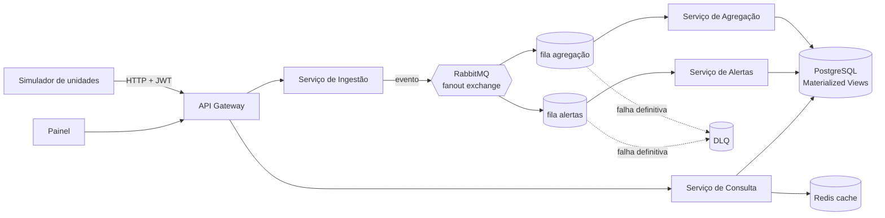

# AlertaSUS: Vigilância Epidemiológica Distribuída

Sistema distribuído, orientado a eventos, para receber notificações de agravos (dengue, chikungunya, síndrome gripal) de várias unidades de saúde e agregá-las por região e semana epidemiológica em painéis quase em tempo real.

> **Disciplina:** Engenharia de Sistemas Distribuídos (2026.2), UFPB
> **Entrega atual:** Projeto 02, arquitetura e base executável.
> **Status:** há uma configuração Docker Compose, CI e quatro serviços Python com endpoints básicos de health check. Os fluxos de negócio ainda não estão implementados.
> **Stack:** veja [docs/stack.md](docs/stack.md) para tecnologias configuradas, instruções locais e itens ainda planejados.
> **Documentação da entrega:** [entrega-2.2.md](entrega-2.2.md) reúne os diagramas C4, os ADRs, o stack, os padrões, o setup e a divisão de responsabilidades.

Todos os dados usados no projeto são **sintéticos**. Nenhuma informação real de pacientes é usada.

## Equipe

| Integrante |
|---|
| Ana Clara Ferreira Epaminondas |
| Gleice Heloise de Araujo Silva |
| Icaro Oliveira de Andrade Fernandes Velasquez Solis |
| João Victor Dias Gonçalves |
| Mateus Fonseca Ferreira e Silva |

## Problema

As notificações de agravos chegam de muitas unidades de saúde e são consolidadas com atraso, o que retarda a detecção de surtos. Em epidemias, o volume de notificações dispara justamente quando o sistema mais precisa responder.

O AlertaSUS recebe as notificações em tempo quase real, separa o recebimento do processamento e agrega os casos por região e semana epidemiológica.

## Solução proposta

Arquitetura de microsserviços orientada a eventos, com escrita e leitura separadas (CQRS).

| Componente | Responsabilidade |
|---|---|
| **API Gateway** | Autentica as unidades (JWT) e aplica rate limiting por unidade |
| **Serviço de Ingestão** | Valida a notificação, garante idempotência pelo ID da notificação e publica o evento no broker |
| **Serviço de Agregação** | Consome os eventos e atualiza as Materialized Views por município, bairro e semana epidemiológica |
| **Serviço de Alertas** | Assina o mesmo tópico (fan-out) e dispara alerta quando uma região passa de um limiar configurável |
| **Serviço de Consulta + Painel** | Lê apenas as views agregadas, com cache |
| **Simulador de unidades de saúde** | Gera notificações sintéticas para demo e testes de carga |

### Visão geral da arquitetura (resumo)



Este diagrama é um resumo do fluxo. Os diagramas C4 (níveis 1 e 2) estão em [`docs/c4/`](docs/c4/) e consolidados no [`entrega-2.2.md`](entrega-2.2.md#1-diagrama-c4); eles detalham também a observabilidade (Prometheus) e indicam quais containers já fazem parte do Compose e quais ainda estão planejados. Os ADRs estão na seção 2 do mesmo documento.

## Padrões arquiteturais e áreas técnicas

São cinco padrões da Seção 5 do enunciado, cobrindo quatro áreas. O mínimo exigido é de 3 padrões e 2 áreas.

| Padrão | Área | Aplicação no projeto |
|---|---|---|
| Queues, PubSub e Messaging Fanout | Escalabilidade | Um evento de notificação alimenta Agregação e Alertas de forma independente |
| Materialized View | Desempenho | Contagens pré-agregadas por região e semana para o painel |
| CQRS | Desempenho | Ingestão (escrita) separada da consulta (leitura) |
| Retry Pattern e DLQ | Confiabilidade | Reprocessamento de falhas transitórias; mensagens inválidas vão para a DLQ |
| API Gateway (autenticação, rate limiting) | Segurança | Uma unidade com excesso de envios não degrada as demais |

## Tecnologias

| Camada | Tecnologia | Situação |
|---|---|---|
| Serviços | Python 3.12 com FastAPI | No Compose (esqueletos com `/health`) |
| Mensageria | RabbitMQ 3.13 (fanout exchange e DLQ nativas) | Broker no Compose; topologia pendente |
| Dados | PostgreSQL 16 (Materialized Views) e Redis 7 (cache de consultas) | No Compose; modelo de dados e cache pendentes |
| Gateway | Kong ou Traefik | Em aberto |
| Painel e observabilidade | Grafana e Prometheus | Planejado |
| Infra e CI | Docker Compose e GitHub Actions | Em uso |
| Testes de carga | k6 | Planejado |

Versões, justificativas e itens pendentes estão em [docs/stack.md](docs/stack.md).

## Critérios de sucesso e plano de testes

| Critério | Meta | Teste que valida |
|---|---|---|
| Vazão de ingestão | ≥ 500 notificações/s com p95 da API < 200 ms | Carga progressiva com k6 |
| Atraso fim a fim (notificação → painel) | p95 ≤ 10 s | Timestamps de envio vs. atualização da view |
| Zero perda de mensagens | Contagem agregada = total enviado | Resiliência: derrubar o Serviço de Agregação durante a carga |
| Idempotência | Reenvio não duplica casos | Integração: mesma notificação enviada 3 vezes |
| Tratamento de inválidas | 100% das inválidas na DLQ | Integração com payloads malformados |
| Isolamento por unidade | Excesso recebe HTTP 429; demais mantêm p95 | Carga com uma unidade abusiva |
| Leitura do painel | p95 < 100 ms sob carga | k6 nas consultas durante a ingestão |

## Cronograma

| Entrega | Conteúdo | Data | Status |
|---|---|---|---|
| Projeto 01 | Grupo, tema, proposta escrita e repositório com README inicial | 09/10/2026 | Entregue |
| Projeto 02 | C4 (níveis 1 e 2), ADRs iniciais, stack, padrões, Docker Compose + CI, divisão de tarefas | 06/11/2026 | Entregue |
| Projeto 03 | Código funcional com testes, documentação final, resultados de testes, apresentação | 11/12/2026 | Pendente |

## Documentação

| Documento | Conteúdo |
|---|---|
| [`entrega-2.2.md`](entrega-2.2.md) | Documento consolidado do Projeto 02: C4, ADRs, stack, padrões, setup, divisão de responsabilidades e uso de IA |
| [`docs/c4/`](docs/c4/) | Diagramas C4 níveis 1 (contexto) e 2 (containers) |
| [`docs/stack.md`](docs/stack.md) | Stack configurado, portas, dependências e itens pendentes |
| [`docs/adr/`](docs/adr/) | Reservado para ADRs em arquivos individuais; por ora os ADRs 0001 a 0004 estão no `entrega-2.2.md` |

## Como executar

### Pré-requisitos

- [Docker](https://docs.docker.com/get-docker/) (v20+)
- [Docker Compose](https://docs.docker.com/compose/install/) (v2)
- (Opcional) `curl` para testar os endpoints manualmente

### Subir o ambiente

Na raiz do repositório:

```bash
docker compose up --build -d
```

Isso constrói as imagens dos microsserviços e sobe **7 containers**:

| Serviço | Porta local | Descrição |
|---|---|---|
| `rabbitmq` | 5672 / 15672 | Broker de mensagens (+ Management UI na 15672) |
| `postgres` | 5432 | Banco de dados relacional |
| `redis` | 6379 | Cache de consultas |
| `ingestion` | 8001 | Serviço de Ingestão (recebe notificações) |
| `aggregation` | 8002 | Serviço de Agregação (atualiza views) |
| `alerts` | 8003 | Serviço de Alertas (detecta surtos) |
| `query` | 8004 | Serviço de Consulta (leitura do painel) |

### Verificar que está tudo no ar

```bash
docker compose ps
```

Você deve ver os **7 containers** com status `Up` (e `(healthy)` para `rabbitmq`, `postgres` e `redis`).

Testar os endpoints de health:

```bash
curl localhost:8001/health   # {"status":"ok","service":"ingestion"}
curl localhost:8002/health   # {"status":"ok","service":"aggregation"}
curl localhost:8003/health   # {"status":"ok","service":"alerts"}
curl localhost:8004/health   # {"status":"ok","service":"query"}
```

### Interface do RabbitMQ

Acesse [http://localhost:15672](http://localhost:15672/) no navegador:

- **Usuário:** `alertasus`
- **Senha:** `alertasus`

### Rodar os testes

Os testes são executados **dentro dos containers**, sem precisar instalar Python localmente:

```bash
for svc in ingestion aggregation alerts query; do
  echo "=== $svc ==="
  docker compose exec $svc ruff check .
  docker compose exec $svc pytest -q
done
```

Alternativamente, rode localmente com um ambiente virtual:

```bash
python3 -m venv .venv
source .venv/bin/activate

cd services/ingestion
pip install -r requirements.txt
ruff check .
pytest -q
```

### Derrubar o ambiente

```bash
docker compose down        # para os containers, preserva os dados do Postgres
docker compose down -v     # para os containers e apaga também o volume (zera o banco)
```

### Estrutura de pastas (relevante para execução)

```text
alertasus/
├── docker-compose.yml           # orquestração dos 7 containers
├── entrega-2.2.md               # documentação consolidada do Projeto 02
├── .github/workflows/ci.yml     # pipeline de CI
├── services/
│   ├── ingestion/               # cada serviço é independente
│   │   ├── Dockerfile
│   │   ├── requirements.txt
│   │   ├── app/main.py
│   │   └── tests/test_health.py
│   ├── aggregation/
│   ├── alerts/
│   └── query/
└── docs/
    ├── c4/                      # diagramas C4 níveis 1 e 2
    ├── adr/                     # reservado para ADRs individuais
    └── stack.md                 # stack configurado e itens pendentes
```

## Ferramentas de IA utilizadas

Esta seção é atualizada a cada entrega.

**Projeto 01**

- **Ferramenta:** Claude Code (Anthropic).
- **Onde atuou:** redação deste README e criação do repositório. O texto foi montado a partir da proposta escrita pela equipe e do enunciado do projeto.
- **Como foi orientada:** recebeu o PDF do enunciado e o documento da proposta do grupo, com a instrução de criar o repositório com o README inicial do Projeto 01.
- **Avaliação:** o conteúdo técnico (problema, arquitetura, padrões, tecnologias e critérios) foi definido pela equipe na proposta; a IA reorganizou esse material no formato de README e esboçou o diagrama preliminar em Mermaid. O diagrama preliminar serviu como ponto de partida e foi substituído pelos diagramas C4 do Projeto 02.

**Projeto 02**

O grupo usou Claude Code (Anthropic) e GitHub Copilot, conforme a disponibilidade de cada integrante. A IA atuou como assistente de pesquisa, redação, geração de estruturas iniciais e diagnóstico de problemas, sem substituir as decisões da equipe, a leitura do código ou a validação do ambiente.

| Frente de trabalho | Onde a IA atuou | Revisão e validação do grupo |
|---|---|---|
| Documentação | Organização do conteúdo da entrega, padronização de títulos, tabelas, listas e explicações técnicas | Conferência contra o enunciado, o README, o Compose e os arquivos versionados |
| Docker Compose | Estrutura inicial para RabbitMQ, PostgreSQL, Redis e os quatro serviços | Revisão das imagens, portas, volumes, rede, variáveis de ambiente e dependências |
| Microsserviços | Esqueletos FastAPI, endpoints básicos e estrutura inicial de testes | Execução dos serviços, conferência dos endpoints de health check e revisão dos arquivos de cada serviço |
| Integração contínua | Estrutura do workflow com matriz para `ingestion`, `aggregation`, `alerts` e `query` | Verificação de `ruff`, `pytest`, `docker compose config -q` e compatibilidade com o repositório |
| Arquitetura C4 | Sugestões de organização textual e de representação dos componentes e fluxos | Revisão dos níveis de contexto e containers, incluindo a distinção entre componentes implementados e planejados |
| Stack tecnológico | Descrição das tecnologias, versões, responsabilidades e comandos locais | Conferência dos `requirements.txt`, Dockerfiles, imagens e configuração efetiva do Compose |
| Diagnóstico do ambiente | Sugestões para problemas como `externally-managed-environment` no Linux | Escolha entre `venv` e execução via Docker, seguida de testes no ambiente local |

- **Como foi orientada:** recebeu o enunciado, a proposta do grupo e o estado do repositório, com pedidos para:
  - transformar a proposta da equipe em documentação Markdown organizada;
  - criar uma configuração inicial executável para os serviços e suas dependências;
  - explicar a finalidade de healthchecks, `depends_on`, redes internas e volumes;
  - estruturar uma matriz de lint e testes no GitHub Actions;
  - revisar inconsistências entre a arquitetura proposta e o que realmente está implementado;
  - sugerir correções para erros de instalação e execução sem alterar as decisões técnicas sem aprovação do grupo.
- **Avaliação:** o uso de IA reduziu o tempo gasto em tarefas repetitivas, como boilerplate, formatação, documentação inicial e configuração de CI. Também ajudou a identificar pontos que precisavam ser documentados, como a diferença entre arquitetura-alvo e funcionalidades já implementadas.
- **O que precisou ser corrigido:** as sugestões não foram aceitas automaticamente. O grupo revisou manualmente nomes de serviços e hostnames internos (que não podem ser substituídos por `localhost` entre containers), portas publicadas e internas, comandos dos healthchecks, dependências `service_healthy`, imagens, versões e dependências Python, sintaxe do Mermaid e coerência dos diagramas C4.
- **Limitações:** a IA pode propor configurações plausíveis, mas incorretas para a versão de uma imagem, para a rede local ou para o estado real do código. Nenhuma saída de IA foi considerada evidência suficiente sem confronto com os arquivos e a execução do projeto. A equipe manteve a responsabilidade por contexto, seleção de alternativas, revisão, testes, ajustes finais e decisões arquiteturais.

Mais detalhes na seção 7 do [`entrega-2.2.md`](entrega-2.2.md#7-ferramentas-de-ia-utilizadas).
