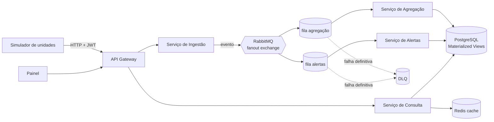

# AlertaSUS: Vigilância Epidemiológica Distribuída

Sistema distribuído, orientado a eventos, para receber notificações de agravos (dengue, chikungunya, síndrome gripal) de várias unidades de saúde e agregá-las por região e semana epidemiológica em painéis quase em tempo real.

> **Disciplina:** Engenharia de Sistemas Distribuídos (2026.2), UFPB
> **Entrega atual:** Projeto 01, definição do grupo e do tema (09/10/2026)
> **Status:** proposta definida e entregue. Ainda não há código neste repositório.

Todos os dados usados no projeto são **sintéticos**. Nenhuma informação real de pacientes é usada.

## Equipe

| Integrante |
|---|
| Ana Clara Ferreira Epaminondas |
| Gleice Heloise de Araujo Silva |
| Icaro Oliveira de Andrade Fernandes Velasquez Solis |
| João Victor Dias Gonçalves |
| Mateus Fonseca Ferreira e Silva |

## Problema

As notificações de agravos chegam de muitas unidades de saúde e são consolidadas com atraso, o que retarda a detecção de surtos. Em epidemias, o volume de notificações dispara justamente quando o sistema mais precisa responder.

O AlertaSUS recebe as notificações em tempo quase real, separa o recebimento do processamento e agrega os casos por região e semana epidemiológica.

## Solução proposta

Arquitetura de microsserviços orientada a eventos, com escrita e leitura separadas (CQRS).

| Componente | Responsabilidade |
|---|---|
| **API Gateway** | Autentica as unidades (JWT) e aplica rate limiting por unidade |
| **Serviço de Ingestão** | Valida a notificação, garante idempotência pelo ID da notificação e publica o evento no broker |
| **Serviço de Agregação** | Consome os eventos e atualiza as Materialized Views por município, bairro e semana epidemiológica |
| **Serviço de Alertas** | Assina o mesmo tópico (fan-out) e dispara alerta quando uma região passa de um limiar configurável |
| **Serviço de Consulta + Painel** | Lê apenas as views agregadas, com cache |
| **Simulador de unidades de saúde** | Gera notificações sintéticas para demo e testes de carga |

### Visão geral da arquitetura (preliminar)

Os diagramas C4 (níveis 1 e 2) e os ADRs entram no Projeto 02.

## Padrões arquiteturais e áreas técnicas

São cinco padrões da Seção 5 do enunciado, cobrindo quatro áreas. O mínimo exigido é de 3 padrões e 2 áreas.

| Padrão | Área | Aplicação no projeto |
|---|---|---|
| Queues, PubSub e Messaging Fanout | Escalabilidade | Um evento de notificação alimenta Agregação e Alertas de forma independente |
| Materialized View | Desempenho | Contagens pré-agregadas por região e semana para o painel |
| CQRS | Desempenho | Ingestão (escrita) separada da consulta (leitura) |
| Retry Pattern e DLQ | Confiabilidade | Reprocessamento de falhas transitórias; mensagens inválidas vão para a DLQ |
| API Gateway (autenticação, rate limiting) | Segurança | Uma unidade com excesso de envios não degrada as demais |

## Tecnologias previstas

| Camada | Tecnologia |
|---|---|
| Serviços | Python com FastAPI |
| Mensageria | RabbitMQ (fanout exchange e DLQ nativas) |
| Dados | PostgreSQL (Materialized Views) e Redis (cache de consultas) |
| Gateway | Kong ou Traefik |
| Painel e observabilidade | Grafana e Prometheus |
| Infra e CI | Docker Compose e GitHub Actions |
| Testes de carga | k6 |

## Critérios de sucesso e plano de testes

| Critério | Meta | Teste que valida |
|---|---|---|
| Vazão de ingestão | ≥ 500 notificações/s com p95 da API < 200 ms | Carga progressiva com k6 |
| Atraso fim a fim (notificação → painel) | p95 ≤ 10 s | Timestamps de envio vs. atualização da view |
| Zero perda de mensagens | Contagem agregada = total enviado | Resiliência: derrubar o Serviço de Agregação durante a carga |
| Idempotência | Reenvio não duplica casos | Integração: mesma notificação enviada 3 vezes |
| Tratamento de inválidas | 100% das inválidas na DLQ | Integração com payloads malformados |
| Isolamento por unidade | Excesso recebe HTTP 429; demais mantêm p95 | Carga com uma unidade abusiva |
| Leitura do painel | p95 < 100 ms sob carga | k6 nas consultas durante a ingestão |

## Cronograma

| Entrega | Conteúdo | Data | Status |
|---|---|---|---|
| Projeto 01 | Grupo, tema, proposta escrita e repositório com README inicial | 09/10/2026 | Entregue |
| Projeto 02 | C4 (níveis 1 e 2), ADRs iniciais, stack, padrões, Docker Compose + CI, divisão de tarefas | 06/11/2026 | Pendente |
| Projeto 03 | Código funcional com testes, documentação final, resultados de testes, apresentação | 11/12/2026 | Pendente |

## Como executar

Ainda não há código. As instruções de execução (Docker Compose) entram a partir do Projeto 02.

## Ferramentas de IA utilizadas

Esta seção é atualizada a cada entrega.

**Projeto 01**

- **Ferramenta:** Claude Code (Anthropic).
- **Onde atuou:** redação deste README e criação do repositório. O texto foi montado a partir da proposta escrita pela equipe e do enunciado do projeto.
- **Como foi orientada:** recebeu o PDF do enunciado e o documento da proposta do grupo, com a instrução de criar o repositório com o README inicial do Projeto 01.
- **Avaliação:** o conteúdo técnico (problema, arquitetura, padrões, tecnologias e critérios) foi definido pela equipe na proposta; a IA reorganizou esse material no formato de README e esboçou o diagrama preliminar em Mermaid. O diagrama ainda passa por revisão da equipe e será substituído pelos diagramas C4 no Projeto 02.
