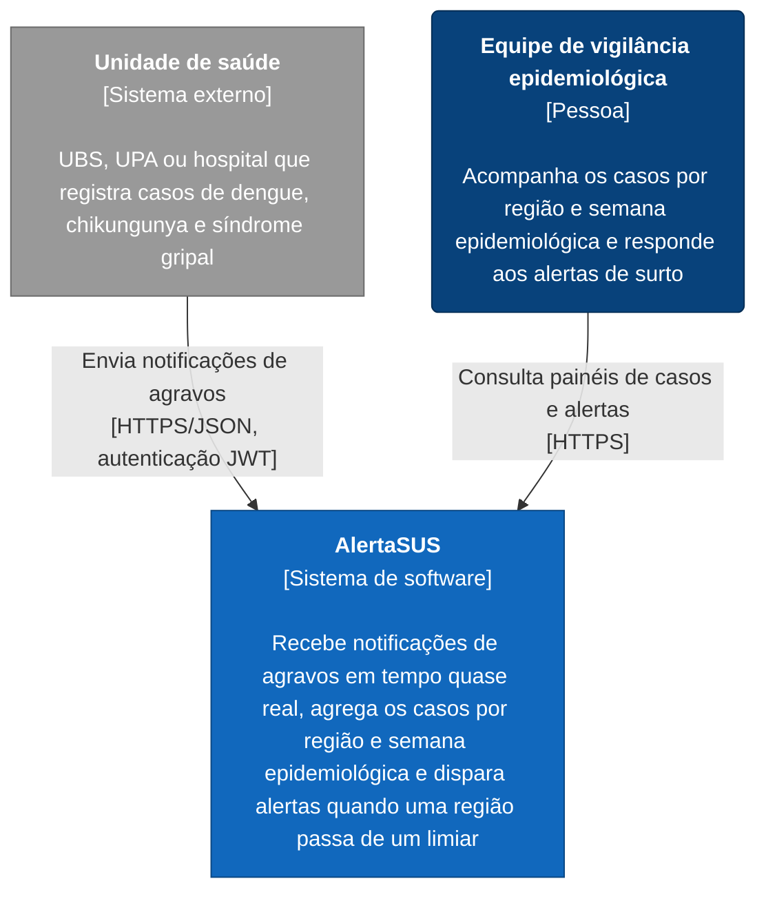

# C4 Nível 1: Diagrama de Contexto

Mostra o AlertaSUS como uma caixa única, quem o usa e com quais sistemas ele troca dados.

## Elementos

| Elemento | Tipo | Descrição |
|---|---|---|
| **AlertaSUS** | Sistema em foco | Recebe as notificações, separa o recebimento do processamento, mantém contagens agregadas por município, bairro e semana epidemiológica e sinaliza regiões que ultrapassam o limiar configurado. |
| **Unidade de saúde** | Sistema externo | Origem das notificações. Cada unidade se autentica com seu próprio token e tem um limite de envio próprio. |
| **Equipe de vigilância epidemiológica** | Pessoa | Usuária final. Usa o painel para acompanhar a evolução dos casos e os alertas disparados. |

## Escopo e premissas

- **Dados sintéticos.** Nenhum sistema real de unidade de saúde é integrado. No projeto, as unidades são representadas pelo **Simulador de unidades de saúde**, que gera notificações sintéticas para a demo e para os testes de carga (aparece no [nível 2](nivel-2-containers.md)).
- **Os alertas aparecem no painel.** A proposta não prevê envio por e-mail, SMS ou outro canal externo, por isso nenhum sistema de notificação aparece no contexto.
- **Fora do escopo:** integração com sistemas oficiais (SINAN, e-SUS) e dados identificáveis de pacientes.
