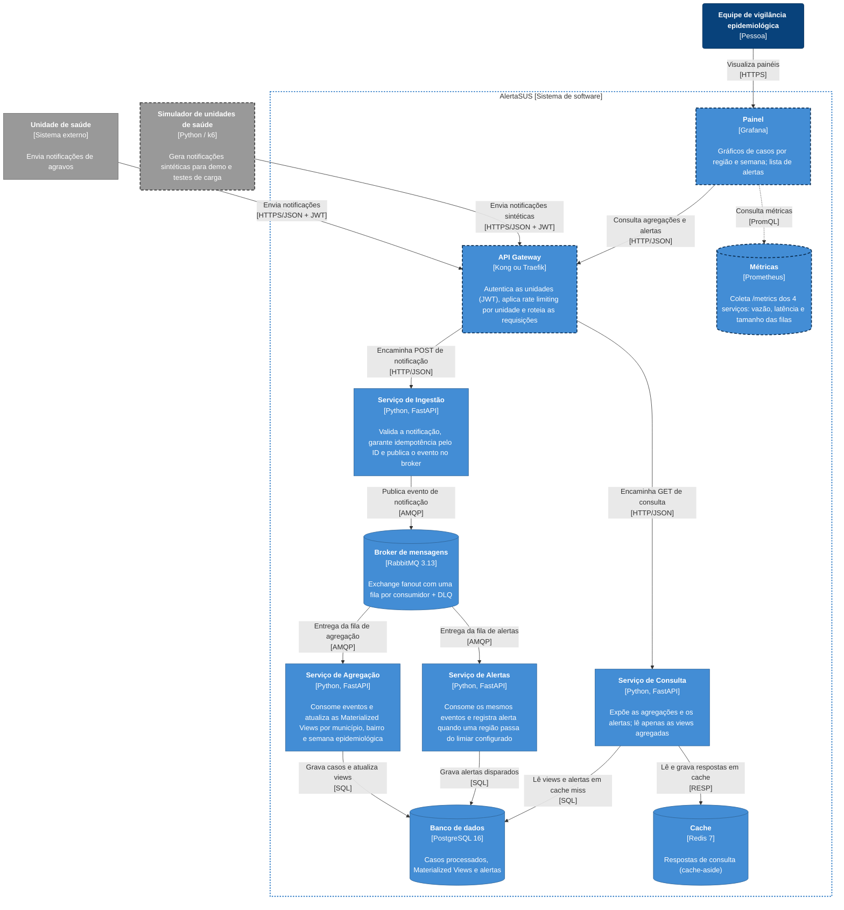

# C4 Nível 2: Diagrama de Containers

Abre a caixa do AlertaSUS e mostra as aplicações e os armazenamentos que o compõem, com as tecnologias e os protocolos entre eles.

Bordas tracejadas indicam containers planejados que ainda não estão no `docker-compose.yml`. Setas pontilhadas são tráfego de observabilidade, fora do fluxo de negócio. O Prometheus coleta `GET /metrics` via HTTP em cada um dos 4 serviços; essas setas foram omitidas para não cruzar o fluxo principal.

## Containers

| Container | Tecnologia | Responsabilidade | Porta local | Status |
|---|---|---|---|---|
| API Gateway | Kong ou Traefik | Ponto único de entrada. Valida o JWT de cada unidade e aplica rate limiting por unidade (HTTP 429 no excesso). | a definir | Planejado |
| Serviço de Ingestão | Python 3.12, FastAPI | Valida o payload, descarta reenvios pelo ID da notificação e publica o evento. Responde rápido porque não processa nada além disso. | 8001 | Esqueleto no compose |
| Broker de mensagens | RabbitMQ 3.13 | Exchange fanout copia cada evento para uma fila por consumidor. Mensagens que esgotam as tentativas vão para a DLQ. | 5672 / 15672 | No compose |
| Serviço de Agregação | Python 3.12, FastAPI | Consome a fila de agregação e mantém as contagens por município, bairro e semana epidemiológica. | 8002 | Esqueleto no compose |
| Serviço de Alertas | Python 3.12, FastAPI | Consome a fila de alertas, compara com o limiar configurado e registra o alerta. | 8003 | Esqueleto no compose |
| Banco de dados | PostgreSQL 16 | Armazena os casos processados, as Materialized Views e os alertas. | 5432 | No compose |
| Serviço de Consulta | Python 3.12, FastAPI | API de leitura do painel. Só lê as views agregadas, com cache-aside no Redis. | 8004 | Esqueleto no compose |
| Cache | Redis 7 | Guarda respostas de consulta com TTL curto para aliviar o Postgres. | 6379 | No compose |
| Painel | Grafana | Interface da equipe de vigilância: casos por região e semana, alertas e métricas técnicas. | a definir | Planejado |
| Métricas | Prometheus | Coleta métricas dos 4 serviços para os testes de carga e para o painel técnico. | a definir | Planejado |
| Simulador de unidades | Python / k6 | Fora da fronteira do sistema. Faz o papel das unidades de saúde na demo e nos testes. | — | Planejado |

## Fluxos principais

**Escrita (notificação → painel):**

1. A unidade (ou o simulador) envia `POST` com a notificação e o JWT ao **API Gateway**.
2. O Gateway valida o token, verifica o limite da unidade e encaminha à **Ingestão**.
3. A Ingestão valida o payload, ignora o reenvio se o ID já foi visto, publica o evento no **RabbitMQ** e responde à unidade.
4. A exchange fanout entrega uma cópia à fila da **Agregação** e outra à fila de **Alertas**. Os dois consomem de forma independente: se um cair, o outro continua e as mensagens dele ficam retidas na fila.
5. A Agregação atualiza as contagens no **PostgreSQL**. Alertas registra um alerta se o limiar for ultrapassado.
6. Falhas transitórias são reprocessadas (retry). Mensagens inválidas ou que esgotam as tentativas vão para a **DLQ**.

**Leitura (painel):**

1. O **Grafana** consulta o **Serviço de Consulta** pelo Gateway.
2. A Consulta procura a resposta no **Redis**. Em cache miss, lê as views no PostgreSQL e grava o resultado no cache.

## Onde cada padrão aparece no diagrama

| Padrão (Seção 5 do enunciado) | Onde aparece |
|---|---|
| Queues, PubSub e Messaging Fanout | Ingestão → exchange fanout → filas de Agregação e Alertas |
| CQRS | Escrita entra pela Ingestão; leitura sai pelo Serviço de Consulta, que nunca escreve |
| Materialized View | Agregação mantém as views no PostgreSQL; Consulta só lê as views |
| Retry Pattern e DLQ | DLQ dentro do broker para mensagens que esgotam as tentativas |
| API Gateway (autenticação, rate limiting) | Gateway entre unidades/painel e os serviços |
| Cache-Aside (complementar) | Consulta ↔ Redis ↔ PostgreSQL |

## Pontos em aberto

Estes itens afetam o diagrama e devem ser fechados nos ADRs (`docs/adr/`) ou no `docs/stack.md`. Depois disso, atualizar este arquivo.

1. **Gateway: Kong ou Traefik.** A escolha muda só a tecnologia na caixa do Gateway.
2. **Onde a Ingestão guarda os IDs já vistos (idempotência).** No compose atual, a Ingestão só tem acesso ao RabbitMQ. As opções são dar a ela acesso ao Redis ou ao PostgreSQL, ou deduplicar na Agregação com uma restrição `UNIQUE` no ID da notificação. Cada opção acrescenta ou move uma seta no diagrama.
3. **Banco compartilhado.** Agregação, Alertas e Consulta usam o mesmo banco `alertasus`, o que é um *shared database* e não um *database-per-service*. Vale registrar esse trade-off num ADR: é mais simples para as Materialized Views, mas acopla os serviços ao mesmo esquema.
4. **Origem dos dados do Grafana.** O diagrama segue a proposta (Grafana → Gateway → Consulta). A alternativa é o Grafana ler o PostgreSQL direto, mais simples de configurar, porém o painel deixaria de passar pelo cache e pela API de leitura.
5. **Containers planejados fora do compose:** Gateway, Grafana, Prometheus e Simulador.
