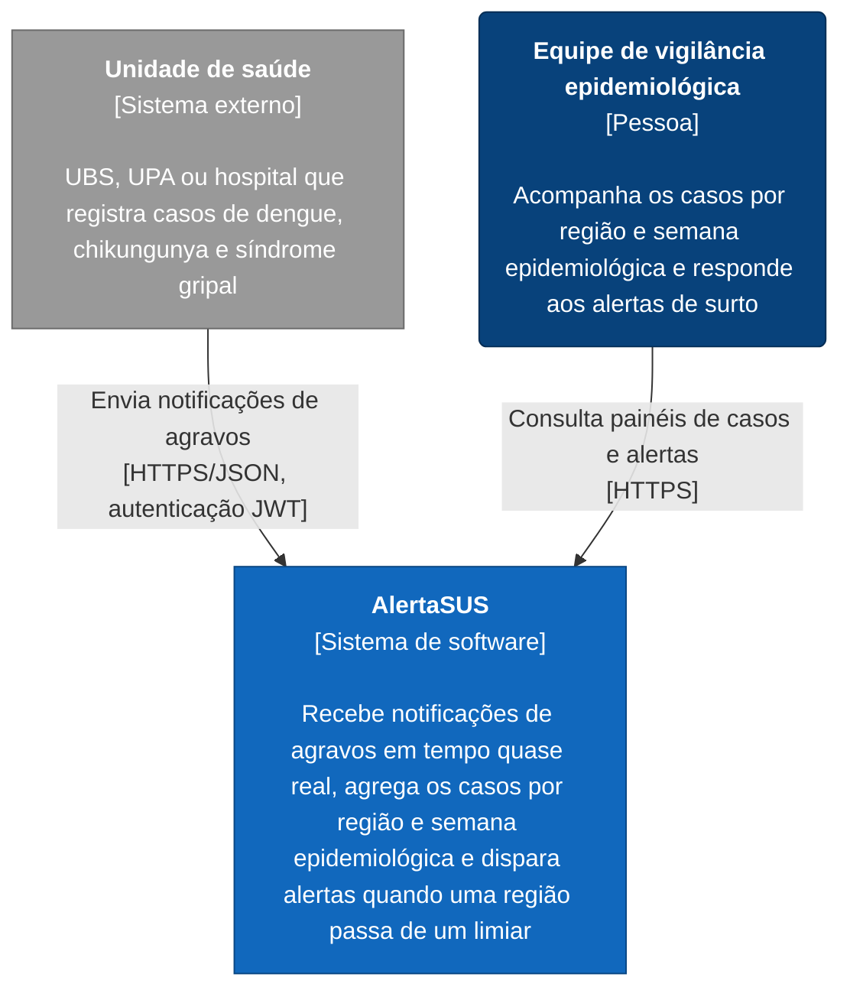
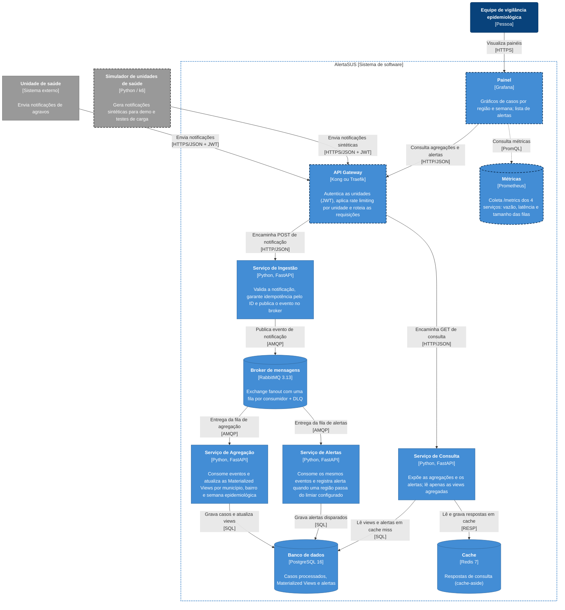

# Entrega 2.2 — Documentação Inicial do Projeto (Projeto 02)

## AlertaSUS — Vigilância Epidemiológica Distribuída

**Disciplina:** Engenharia de Sistemas Distribuídos — 2026.2  
**Repositório:** [github.com/mateusfonsek/alertasus](https://github.com/mateusfonsek/alertasus)  
**Arquitetura:** Microsserviços orientados a eventos com CQRS  
**Dados:** 100% sintéticos, gerados por um simulador

## Equipe

- Ana Clara Ferreira Epaminondas
- Gleice Heloise de Araujo Silva
- Icaro Oliveira de Andrade Fernandes Velasquez Solis
- João Victor Dias Gonçalves
- Mateus Fonseca Ferreira e Silva

Este documento consolida a entrega do Projeto 02, reunindo a arquitetura proposta, as decisões técnicas, os padrões adotados e o setup executável do ambiente. O API Gateway faz parte da arquitetura lógica e está representado nos diagramas C4; nesta etapa, o `docker-compose.yml` sobe os quatro microsserviços de aplicação e os três componentes de infraestrutura.

## 1. Diagrama C4

Os diagramas abaixo utilizam a notação C4 e são renderizados em Mermaid pelo GitHub. Eles foram elaborados por Ana Clara e incorporados integralmente a esta entrega para consolidar as contribuições da equipe em um único documento.

### Nível 1 — Contexto

O diagrama de contexto mostra o AlertaSUS como uma caixa única, seus usuários e os sistemas com os quais troca dados.



#### Elementos do contexto

| Elemento | Tipo | Descrição |
|---|---|---|
| **AlertaSUS** | Sistema em foco | Recebe as notificações, separa o recebimento do processamento, mantém contagens agregadas por município, bairro e semana epidemiológica e sinaliza regiões que ultrapassam o limiar configurado. |
| **Unidade de saúde** | Sistema externo | Origem das notificações. Cada unidade se autentica com seu próprio token e tem um limite de envio próprio. |
| **Equipe de vigilância epidemiológica** | Pessoa | Usuária final. Usa o painel para acompanhar a evolução dos casos e os alertas disparados. |

#### Escopo e premissas

- **Dados sintéticos.** Nenhum sistema real de unidade de saúde é integrado. No projeto, as unidades são representadas pelo **Simulador de unidades de saúde**, que gera notificações sintéticas para a demonstração e para os testes de carga.
- **Os alertas aparecem no painel.** A proposta não prevê envio por e-mail, SMS ou outro canal externo; por isso, nenhum sistema de notificação aparece no contexto.
- **Fora do escopo:** integração com sistemas oficiais (SINAN, e-SUS) e dados identificáveis de pacientes.

### Nível 2 — Containers

O nível 2 abre a caixa do AlertaSUS e detalha o API Gateway, os serviços de ingestão, agregação, alertas e consulta, além do RabbitMQ, PostgreSQL e Redis. As bordas tracejadas indicam componentes planejados que ainda não fazem parte do `docker-compose.yml`.



As setas pontilhadas representam tráfego de observabilidade, fora do fluxo de negócio. O Prometheus coleta `GET /metrics` via HTTP em cada um dos quatro serviços; essas setas foram omitidas do fluxo principal para preservar a legibilidade do diagrama.

#### Containers

| Container | Tecnologia | Responsabilidade | Porta local | Status |
|---|---|---|---:|---|
| API Gateway | Kong ou Traefik | Ponto único de entrada. Valida o JWT de cada unidade e aplica rate limiting por unidade (HTTP 429 no excesso). | a definir | Planejado |
| Serviço de Ingestão | Python 3.12, FastAPI | Valida o payload, descarta reenvios pelo ID da notificação e publica o evento. Responde rapidamente porque não processa além disso. | 8001 | Esqueleto no Compose |
| Broker de mensagens | RabbitMQ 3.13 | Exchange fanout copia cada evento para uma fila por consumidor. Mensagens que esgotam as tentativas vão para a DLQ. | 5672 / 15672 | No Compose |
| Serviço de Agregação | Python 3.12, FastAPI | Consome a fila de agregação e mantém as contagens por município, bairro e semana epidemiológica. | 8002 | Esqueleto no Compose |
| Serviço de Alertas | Python 3.12, FastAPI | Consome a fila de alertas, compara com o limiar configurado e registra o alerta. | 8003 | Esqueleto no Compose |
| Banco de dados | PostgreSQL 16 | Armazena os casos processados, as Materialized Views e os alertas. | 5432 | No Compose |
| Serviço de Consulta | Python 3.12, FastAPI | API de leitura do painel. Só lê as views agregadas, com cache-aside no Redis. | 8004 | Esqueleto no Compose |
| Cache | Redis 7 | Guarda respostas de consulta com TTL curto para aliviar o PostgreSQL. | 6379 | No Compose |
| Painel | Grafana | Interface da equipe de vigilância: casos por região e semana, alertas e métricas técnicas. | a definir | Planejado |
| Métricas | Prometheus | Coleta métricas dos quatro serviços para os testes de carga e para o painel técnico. | a definir | Planejado |
| Simulador de unidades | Python / k6 | Fica fora da fronteira do sistema e representa as unidades de saúde na demonstração e nos testes. | — | Planejado |

#### Fluxos principais

**Escrita (notificação → painel):**

1. A unidade ou o simulador envia `POST` com a notificação e o JWT ao **API Gateway**.
2. O Gateway valida o token, verifica o limite da unidade e encaminha a requisição à **Ingestão**.
3. A Ingestão valida o payload, ignora o reenvio se o ID já foi visto, publica o evento no **RabbitMQ** e responde à unidade.
4. A exchange fanout entrega uma cópia à fila da **Agregação** e outra à fila de **Alertas**. Os dois consumidores trabalham de forma independente.
5. A Agregação atualiza as contagens no **PostgreSQL**. O Serviço de Alertas registra um alerta se o limiar for ultrapassado.
6. Falhas transitórias são reprocessadas. Mensagens inválidas ou que esgotam as tentativas vão para a **DLQ**.

**Leitura (painel):**

1. O **Grafana** consulta o **Serviço de Consulta** pelo Gateway.
2. A Consulta procura a resposta no **Redis**. Em caso de cache miss, lê as views no PostgreSQL e grava o resultado no cache.

#### Relação entre padrões e componentes

| Padrão | Onde aparece |
|---|---|
| Queues, Pub/Sub e Messaging Fanout | Ingestão → exchange fanout → filas de Agregação e Alertas |
| CQRS | Escrita entra pela Ingestão; leitura sai pelo Serviço de Consulta, que não escreve |
| Materialized View | Agregação mantém as views no PostgreSQL; Consulta lê as views |
| Retry Pattern e DLQ | DLQ dentro do broker para mensagens que esgotam as tentativas |
| API Gateway | Gateway entre unidades/painel e os serviços, com autenticação e rate limiting |
| Cache-Aside (complementar) | Consulta ↔ Redis ↔ PostgreSQL |

#### Pontos em aberto da arquitetura

1. **Gateway: Kong ou Traefik.** A escolha altera a tecnologia exibida na caixa do Gateway.
2. **Armazenamento dos IDs já vistos pela Ingestão.** No Compose atual, a Ingestão só tem acesso ao RabbitMQ. As alternativas são dar acesso ao Redis ou ao PostgreSQL, ou deduplicar na Agregação com uma restrição `UNIQUE` no ID da notificação.
3. **Banco compartilhado.** Agregação, Alertas e Consulta usam o mesmo banco `alertasus`, caracterizando um *shared database*, e não *database-per-service*. Isso simplifica as Materialized Views, mas acopla os serviços ao mesmo esquema.
4. **Origem dos dados do Grafana.** O diagrama segue a proposta de Grafana → Gateway → Consulta. Uma alternativa seria o Grafana ler o PostgreSQL diretamente, mas isso eliminaria o cache e a API de leitura.
5. **Containers planejados fora do Compose.** Gateway, Grafana, Prometheus e Simulador ainda não fazem parte do ambiente executável desta entrega.

- Referência dos arquivos-fonte: [`docs/c4/nivel-1-contexto.md`](docs/c4/nivel-1-contexto.md) e [`docs/c4/nivel-2-containers.md`](docs/c4/nivel-2-containers.md).

## 2. ADRs — Architecture Decision Records

Os ADRs abaixo registram, nesta entrega, o contexto, a decisão e os trade-offs das principais escolhas arquiteturais. Eles estão documentados integralmente neste arquivo; o diretório [`docs/adr/`](docs/adr/) permanece reservado para uma futura separação dos registros em arquivos individuais.

### ADR 0001 — Microsserviços com CQRS

**Status:** Aceito — arquitetura-base do Projeto 02.

**Contexto e problema:** O AlertaSUS recebe notificações de várias unidades de saúde e precisa continuar aceitando novos eventos mesmo quando há um pico de volume. Ao mesmo tempo, a equipe de vigilância precisa consultar agregações e alertas com baixa latência. Se o mesmo componente recebesse, validasse, processasse, agregasse e consultasse todos os dados de forma síncrona, uma carga elevada de escrita poderia degradar o painel e dificultar a evolução independente das funcionalidades.

**Forças que influenciaram a decisão:**

- separar o recebimento rápido das notificações do processamento mais pesado;
- permitir escalabilidade independente dos fluxos de escrita e leitura;
- reduzir o acoplamento entre ingestão, agregação, alertas e consulta;
- manter o caminho de leitura otimizado para as necessidades do painel;
- facilitar a evolução dos serviços sem transformar uma alteração em um deploy monolítico.

**Decisão:** Adotar uma arquitetura de microsserviços com CQRS. O Serviço de Ingestão representa a entrada de comandos e notificações; Agregação e Alertas processam os eventos de forma assíncrona; e o Serviço de Consulta representa o lado de leitura, acessando dados agregados e cache. A separação é lógica e também estrutural: cada serviço possui seu próprio diretório, `Dockerfile`, `requirements.txt`, aplicação FastAPI e testes.

**Alternativas consideradas:**

1. **Aplicação monolítica síncrona:** seria mais simples no início, mas concentraria os picos de escrita e leitura no mesmo processo e dificultaria o isolamento dos componentes.
2. **Serviço único com módulos internos:** reduziria a complexidade operacional, porém manteria maior acoplamento de implantação e de escala.
3. **Separação completa com bancos independentes desde o início:** ofereceria isolamento maior, mas aumentaria a complexidade de consistência, migrações e operação para o estágio inicial do projeto.

**Consequências positivas:**

- ingestão, processamento e consulta podem ser dimensionados separadamente;
- uma falha ou lentidão no processamento não precisa interromper imediatamente a entrada de notificações;
- as responsabilidades ficam explícitas e alinhadas aos limites dos serviços;
- o modelo de leitura pode ser otimizado para consultas agregadas.

**Consequências negativas e riscos:**

- surge consistência eventual entre a notificação recebida e o dado exibido no painel;
- rastreamento, observabilidade e diagnóstico ficam mais complexos;
- eventos podem ser duplicados ou processados fora de ordem, exigindo idempotência;
- a solução depende de contratos estáveis entre serviços e de mecanismos de retry.

**Relação com a implementação:** A decisão já aparece na separação dos quatro serviços FastAPI e no Compose. Nesta entrega, eles ainda possuem endpoints básicos de health check; consumidores, comandos, consultas e persistência de negócio serão implementados nas próximas etapas.

### ADR 0002 — RabbitMQ com fanout e Dead-Letter Queue

**Status:** Aceito — infraestrutura preparada; topologia de negócio pendente.

**Contexto e problema:** Cada notificação deve alimentar pelo menos dois processamentos independentes: a atualização das agregações e a verificação de limiares para geração de alertas. O produtor não deve precisar conhecer a implementação ou a disponibilidade de cada consumidor. Além disso, uma falha temporária não deve descartar o evento, enquanto uma mensagem inválida não deve ser repetida indefinidamente e bloquear a fila.

**Forças que influenciaram a decisão:**

- distribuição de um mesmo evento para múltiplos consumidores;
- desacoplamento temporal entre produtor e consumidores;
- possibilidade de cada consumidor ter sua própria fila e ritmo de processamento;
- confirmação de entrega e retenção durante indisponibilidades;
- tratamento explícito de falhas permanentes por meio da DLQ.

**Decisão:** Adotar RabbitMQ como broker assíncrono. O Serviço de Ingestão publicará notificações em uma exchange `fanout`; essa exchange distribuirá cópias para uma fila de Agregação e uma fila de Alertas. Mensagens com falhas transitórias deverão passar por retry controlado. Mensagens inválidas ou que excederem o limite de tentativas deverão ser encaminhadas para uma Dead-Letter Queue, preservando o conteúdo para investigação e possível reprocessamento.

**Alternativas consideradas:**

1. **Chamadas HTTP síncronas entre Ingestão, Agregação e Alertas:** simplificariam o fluxo inicial, mas aumentariam o acoplamento e fariam a disponibilidade do produtor depender dos consumidores.
2. **Redis Streams:** poderia atender a parte do fluxo, mas RabbitMQ oferece recursos mais diretamente alinhados a exchanges, filas, confirmações e DLQs.
3. **Kafka:** seria adequado para alto volume e retenção de eventos, porém adicionaria complexidade operacional desnecessária para o escopo atual.
4. **Uma única fila compartilhada:** não permitiria que Agregação e Alertas recebessem independentemente a mesma notificação.

**Consequências positivas:**

- Agregação e Alertas podem parar ou escalar de forma independente;
- mensagens podem aguardar enquanto um consumidor está indisponível;
- a DLQ evita perda silenciosa e facilita diagnóstico;
- o produtor permanece desacoplado da lógica dos consumidores.

**Consequências negativas e riscos:**

- a topologia precisa ser configurada corretamente, incluindo exchange, filas, bindings e políticas;
- retry mal configurado pode causar tempestade de mensagens ou reprocessamento infinito;
- consumidores precisam ser idempotentes para lidar com redelivery;
- é necessário monitorar tamanho das filas, idade das mensagens e volume da DLQ;
- a ordem global dos eventos não é garantida entre consumidores independentes.

**Relação com a implementação:** O container RabbitMQ, suas portas e sua URL interna já estão definidos no `docker-compose.yml`. A exchange, as filas, os consumidores, as confirmações e a DLQ ainda não foram implementados nesta base.

### ADR 0003 — PostgreSQL e Redis com Materialized Views

**Status:** Aceito — componentes disponíveis; modelo de dados pendente.

**Contexto e problema:** O painel precisa consultar casos por município, bairro e semana epidemiológica, além de alertas disparados. Fazer agregações diretamente sobre todos os eventos a cada requisição aumentaria o custo da leitura e poderia comprometer a meta de p95 inferior a 100 ms. Também é necessário manter uma fonte persistente e consistente para os dados, sem transformar o cache na única fonte de verdade.

**Forças que influenciaram a decisão:**

- necessidade de consultas agregadas por dimensões epidemiológicas;
- persistência relacional e consistência transacional para os dados processados;
- redução do custo de recomputar agregações;
- baixa latência para consultas repetidas;
- possibilidade de reconstruir ou atualizar o cache a partir do PostgreSQL.

**Decisão:** Utilizar PostgreSQL como fonte persistente para notificações processadas, agregações e alertas. O Serviço de Agregação deverá manter Materialized Views por município, bairro e semana epidemiológica. O Serviço de Consulta deverá seguir o padrão cache-aside: primeiro consulta o Redis; em caso de cache miss, consulta as views no PostgreSQL e grava a resposta no Redis com TTL definido.

**Alternativas consideradas:**

1. **Calcular as agregações em cada requisição:** reduziria a necessidade de atualização de views, mas aumentaria a latência e o uso de CPU/banco sob carga.
2. **Usar somente Redis:** ofereceria baixa latência, porém não seria adequado como fonte principal durável para o histórico e dificultaria reconstrução dos dados.
3. **Usar somente PostgreSQL sem cache:** simplificaria a operação, mas perderia desempenho em consultas repetidas e concorrentes.
4. **Banco NoSQL:** poderia facilitar algumas escritas, mas não oferece vantagem suficiente para as consultas relacionais e agregações previstas nesta etapa.

**Consequências positivas:**

- as consultas leem resultados pré-agregados;
- o Redis reduz leituras repetidas no PostgreSQL;
- o PostgreSQL permanece como fonte de recuperação quando o cache expira;
- a combinação atende à meta de desempenho sem sacrificar a persistência relacional.

**Consequências negativas e riscos:**

- Materialized Views podem ficar desatualizadas até sua atualização;
- o cache pode devolver respostas temporariamente antigas;
- TTL e invalidação precisam ser definidos por tipo de consulta;
- alterações no modelo de dados exigirão migrações e possível reconstrução das views;
- o PostgreSQL compartilhado cria acoplamento entre Agregação, Alertas e Consulta.

**Relação com a implementação:** PostgreSQL, Redis, volume `pg_data` e variáveis de conexão já estão declarados no Compose. Ainda não existem schema, migrações, Materialized Views, consultas de negócio ou integração efetiva com Redis nesta entrega.

### ADR 0004 — Docker Compose para desenvolvimento e CI

**Status:** Aceito — padrão de execução local e validação contínua.

**Contexto e problema:** O projeto possui quatro microsserviços Python e três componentes de infraestrutura. Instalar e configurar tudo manualmente em cada máquina produziria diferenças de ambiente, problemas de dependência e uma entrada mais difícil para novos integrantes. O pipeline também precisa verificar se a composição continua válida.

**Forças que influenciaram a decisão:**

- execução local com um comando padronizado;
- isolamento de dependências entre serviços;
- rede interna reproduzível;
- healthchecks para controlar a ordem de inicialização;
- validação automatizada no GitHub Actions;
- baixo custo operacional para o estágio acadêmico do projeto.

**Decisão:** Utilizar Docker Compose v2 para orquestrar RabbitMQ, PostgreSQL, Redis e os quatro microsserviços em uma rede comum. Cada microsserviço possui seu próprio `Dockerfile` e `requirements.txt`. O Compose usa `depends_on` com `service_healthy`; o CI executa `docker compose config -q`, além de lint e testes em uma matriz por serviço.

**Alternativas consideradas:**

1. **Execução manual com Python local:** exigiria instalação e configuração repetidas, além de aumentar diferenças entre ambientes.
2. **Um único Dockerfile para toda a aplicação:** reduziria arquivos, mas eliminaria o isolamento de dependências e processos.
3. **Kubernetes desde o início:** seria mais próximo de uma operação de produção, porém desproporcional à escala e ao objetivo desta entrega.
4. **Máquinas virtuais ou scripts específicos por sistema operacional:** aumentariam a manutenção e reduziriam a portabilidade.

**Consequências positivas:**

- ambiente local reproduzível para toda a equipe;
- containers isolados e conectados por nomes de serviço;
- infraestrutura e serviços podem ser iniciados, verificados e encerrados de forma uniforme;
- o CI detecta erros de sintaxe e de qualidade antes da integração;
- o volume `pg_data` preserva os dados do PostgreSQL entre reinicializações comuns.

**Consequências negativas e riscos:**

- Docker passa a ser um pré-requisito para execução completa;
- os containers consomem memória, CPU e portas locais;
- credenciais no Compose são aceitáveis apenas para desenvolvimento local;
- o volume do PostgreSQL exige limpeza consciente com `docker compose down -v`;
- Compose não fornece, sozinho, alta disponibilidade, autoscaling ou observabilidade de produção.

**Relação com a implementação:** O ambiente é iniciado com `docker compose up --build -d` e contém sete containers: RabbitMQ, PostgreSQL, Redis, Ingestão, Agregação, Alertas e Consulta. Os healthchecks usam `rabbitmq-diagnostics`, `pg_isready` e `redis-cli ping`; o workflow do GitHub Actions valida o Compose e executa `ruff` e `pytest` para os quatro serviços.

## 3. Stack tecnológico

| Camada | Tecnologia | Uso no projeto | Justificativa |
|---|---|---|---|
| Linguagem e runtime | Python 3.12 (`python:3.12-slim`) | Runtime dos quatro serviços | **Gleice:** linguagem produtiva, com bom suporte para APIs assíncronas e bibliotecas maduras para sistemas distribuídos. |
| Framework HTTP | FastAPI 0.115.5 | API mínima dos serviços | **Gleice:** framework leve, tipado e adequado à construção de APIs HTTP assíncronas com documentação automática. |
| Servidor ASGI | Uvicorn 0.32.1 | Expõe cada API na porta 8000 do container | **Gleice:** servidor ASGI compatível com FastAPI e adequado ao processamento concorrente de requisições. |
| Comunicação assíncrona | RabbitMQ 3.13 (`rabbitmq:3.13-management`) | Exchange `fanout`, filas de consumidores e DLQ | **Gleice:** broker consolidado para entrega assíncrona, distribuição fanout, confirmação de mensagens e tratamento de falhas. |
| Persistência relacional | PostgreSQL 16 (`postgres:16-alpine`) | Dados processados, alertas e Materialized Views | **Gleice:** banco relacional robusto, com suporte a consultas agregadas, consistência transacional e visões materializadas. |
| Cache | Redis 7 (`redis:7-alpine`) | Cache-aside das respostas de consulta | **Gleice:** armazenamento em memória de baixa latência para reduzir leituras repetidas no PostgreSQL. |
| Empacotamento e orquestração | Docker e Docker Compose v2 | Ambiente reprodutível e rede interna dos serviços | **Gleice:** padroniza a execução local, o isolamento dos serviços e a conexão entre containers pela rede `alertasus-net`. |
| Testes | Pytest 8.3.3 e HTTPX 0.27.2 | Testes automatizados dos endpoints básicos | **Gleice:** permite validar os serviços de forma independente e simular requisições HTTP nos testes. |
| Lint | Ruff 0.7.4 | Verificação estática dos serviços | **Gleice:** fornece feedback rápido e uniforme sobre problemas de estilo e qualidade do código Python. |
| Qualidade e integração contínua | GitHub Actions | Lint, testes automatizados e validação do Compose | **Gleice:** automatiza as verificações a cada alteração e reduz o risco de integrar uma configuração inválida. |
| Diagramas | Mermaid no Markdown | Documentação C4 versionada no repositório | **Gleice:** mantém a arquitetura próxima do código, revisável por pull request e renderizável diretamente no GitHub. |

### 3.1 Stack executável nesta entrega

O estado atual corresponde à base executável do Projeto 02. Os quatro serviços Python estão implementados como esqueletos com os endpoints `GET /health` e `GET /`. Os fluxos de negócio descritos na arquitetura-alvo ainda não estão implementados.

As dependências Python acima estão declaradas nos `requirements.txt` dos serviços. Atualmente, os quatro arquivos possuem o mesmo conjunto de dependências.

| Serviço | Porta local | Dependências declaradas no Compose |
|---|---:|---|
| `ingestion` | 8001 | RabbitMQ |
| `aggregation` | 8002 | RabbitMQ e PostgreSQL |
| `alerts` | 8003 | RabbitMQ e PostgreSQL |
| `query` | 8004 | PostgreSQL e Redis |
| `rabbitmq` | 5672, 15672 | — |
| `postgres` | 5432 | — |
| `redis` | 6379 | — |

O PostgreSQL persiste dados no volume nomeado `pg_data`. RabbitMQ e Redis não possuem volumes configurados; portanto, seus dados não devem ser considerados persistentes ao recriar os containers.

### 3.2 Arquitetura-alvo e itens pendentes

As tecnologias e padrões abaixo fazem parte da proposta, mas não devem ser confundidos com funcionalidades já disponíveis no Compose:

| Item | Estado | Observação |
|---|---|---|
| RabbitMQ com fanout, filas de consumidores, retry e DLQ | Planejado | O broker está no Compose; topologia, consumidores e política de retry/DLQ ainda precisam ser implementados. |
| PostgreSQL com dados de domínio e Materialized Views | Planejado | O banco está no Compose; esquema, migrações e views ainda não estão definidos no código atual. |
| Redis como cache-aside do Serviço de Consulta | Planejado | Redis está no Compose; integração e política de expiração ainda não foram implementadas. |
| API Gateway | Em aberto | Kong ou Traefik; autenticação JWT, rate limiting e roteamento estão previstos. |
| Painel | Planejado | Grafana é a tecnologia prevista; não há container configurado. |
| Coleta de métricas | Planejado | Prometheus é a tecnologia prevista; não há container nem endpoints `/metrics` configurados. |
| Carga e simulação | Planejado | k6 está previsto para carga; o simulador de unidades também não está no repositório atual. |
| Idempotência de notificações | Em aberto | É necessário definir onde manter os IDs e qual serviço será responsável pela deduplicação. |
| Persistência por serviço | Decisão arquitetural pendente | O Compose atual prevê um PostgreSQL compartilhado; o trade-off frente a *database-per-service* deve ser registrado em ADR. |

### 3.3 Configuração e segurança

- Os valores atuais de configuração estão declarados diretamente no Compose para execução local; não são adequados para produção.
- As credenciais de desenvolvimento não devem ser usadas fora do ambiente local. Antes de qualquer implantação compartilhada, elas devem ser movidas para variáveis de ambiente ou um gerenciador de segredos.
- As portas dos serviços de infraestrutura são publicadas no host para facilitar o desenvolvimento local. Em ambientes compartilhados, devem ser restringidas ou removidas quando não forem necessárias.
- Todos os dados do projeto devem permanecer sintéticos; não devem ser usados dados pessoais ou dados reais de pacientes.

### 3.4 Comandos de validação local

Após subir o ambiente conforme a [seção 5](#5-setup-inicial--docker-e-ci), os endpoints básicos podem ser verificados com:

```bash
curl http://localhost:8001/health
curl http://localhost:8002/health
curl http://localhost:8003/health
curl http://localhost:8004/health
```

Para validar o código Python localmente, com as dependências instaladas, o mesmo conjunto de verificações usado pelo CI pode ser executado por serviço:

```bash
for svc in ingestion aggregation alerts query; do
  (cd "services/$svc" && ruff check . && pytest -q)
done
```

Detalhes dos containers, fluxos e padrões estão nos [diagramas C4](#1-diagrama-c4). Quando uma decisão pendente for tomada, ela deve ser registrada em um ADR e refletida neste documento e no diagrama correspondente.

## 4. Padrões arquiteturais

### 4.1 Queues/PubSub Fanout

O Serviço de Ingestão deverá publicar cada evento em uma exchange `fanout`, que entregará uma cópia para a fila de Agregação e outra para a fila de Alertas. Assim, os consumidores processam a mesma notificação sem acoplamento direto. RabbitMQ já está no Compose, mas exchange, filas e consumidores ainda estão planejados.

### 4.2 Materialized View

O Serviço de Agregação deverá transformar os eventos em contagens por município, bairro e semana epidemiológica no PostgreSQL. O Serviço de Consulta lerá as views agregadas em vez de recalcular os eventos, com o Redis armazenando respostas frequentes. PostgreSQL e Redis já estão no Compose; esquema, views e atualização ainda não foram implementados.

### 4.3 CQRS

CQRS separa o modelo de escrita do modelo de leitura. A escrita entra pelo Serviço de Ingestão e segue para o processamento assíncrono de Agregação e Alertas; a leitura passa pelo Serviço de Consulta, que deverá acessar as Materialized Views e o cache Redis sem alterar os dados de origem. A separação já aparece nos quatro serviços FastAPI e nas portas 8001 a 8004 do Compose.

### 4.4 Retry/DLQ

O Retry Pattern repete o processamento em falhas transitórias. Mensagens malformadas ou que excederem o limite de tentativas devem ser encaminhadas para a DLQ. O padrão será aplicado nas filas de Agregação e Alertas; a política ainda não está configurada no código atual.

### 4.5 API Gateway

O Gateway está previsto entre as unidades/painel e os microsserviços. Deverá validar JWT, aplicar rate limiting por unidade e rotear `POST` de notificações para Ingestão e `GET` de consultas para o Serviço de Consulta. Kong ou Traefik ainda não foi escolhido e o Gateway não está no Compose; os serviços expõem portas diretamente no desenvolvimento local.

### 4.6 Síntese dos padrões

Os padrões trabalham em conjunto: o API Gateway controla a entrada; CQRS separa escrita e leitura; fanout distribui eventos; Materialized Views e Redis aceleram consultas; e Retry/DLQ preserva a resiliência do processamento. Essa combinação atende às metas de escalabilidade, desempenho, confiabilidade e segurança previstas para o AlertaSUS, embora parte da implementação permaneça como trabalho do Projeto 03.

> **Status de implementação:** CQRS está refletido na separação dos quatro serviços e no Compose; os demais padrões de mensageria, persistência agregada, cache, retry/DLQ e Gateway estão documentados como arquitetura-alvo e ainda não possuem implementação funcional nesta base do Projeto 02.

## 5. Setup inicial — Docker e CI

### 5.1 Execução local

O ambiente completo é iniciado com:

```bash
docker compose up --build -d
```

Nesta etapa, o Compose sobe **7 containers**:

- **3 containers de infraestrutura:** RabbitMQ, PostgreSQL e Redis;
- **4 containers de microsserviços:** Ingestão, Agregação, Alertas e Consulta.

Os serviços compartilham a rede interna `alertasus-net`. Por isso, a comunicação entre containers utiliza os hostnames definidos pelos nomes dos serviços, como `rabbitmq`, `postgres` e `redis`, em vez de `localhost`.

### 5.2 Ordem de inicialização e healthchecks

O arquivo `docker-compose.yml` utiliza `depends_on` com `condition: service_healthy`. Assim, um microsserviço só é iniciado depois que as dependências de infraestrutura estiverem prontas e aprovadas pelos respectivos healthchecks:

- PostgreSQL: `pg_isready -U alertasus -d alertasus`;
- RabbitMQ: `rabbitmq-diagnostics check_port_connectivity`;
- Redis: `redis-cli ping`.

Esse mecanismo evita que os microsserviços tentem conectar-se a dependências ainda indisponíveis durante a inicialização. Ele controla a ordem de partida; a aplicação continua responsável por tratar falhas de conexão posteriores.

### 5.3 Isolamento dos microsserviços

Cada microsserviço possui seu próprio `Dockerfile` e `requirements.txt` dentro de `services/`. Esse isolamento permite que cada imagem instale suas dependências de forma independente, execute seu próprio processo FastAPI/Uvicorn e evolua sem compartilhar o ambiente de execução dos demais serviços.

As portas locais expostas são:

| Serviço | Porta local |
|---|---:|
| Ingestão | 8001 |
| Agregação | 8002 |
| Alertas | 8003 |
| Consulta | 8004 |

### 5.4 Integração contínua

O workflow [`.github/workflows/ci.yml`](.github/workflows/ci.yml) executa uma matriz em paralelo para os quatro serviços (`ingestion`, `aggregation`, `alerts` e `query`). Para cada item da matriz, o CI:

1. configura o Python 3.12;
2. instala o `requirements.txt` específico do serviço;
3. executa `ruff check .`;
4. executa `pytest -q`.

Em um job separado, o workflow valida a sintaxe e a resolução do Compose com:

```bash
docker compose config -q
```

Dessa forma, a entrega verifica tanto a qualidade do código de cada microsserviço quanto a consistência do ambiente distribuído antes do merge.

## 6. Divisão de responsabilidades

| Integrante | Responsabilidade | Entrega relacionada |
|---|---|---|
| Ana Clara | Diagramas C4 | Níveis 1 e 2, contexto, containers e fluxos arquiteturais |
| Gleice | Stack tecnológico | Tecnologias adotadas e justificativas técnicas |
| Icaro | Setup e CI | Docker Compose, Dockerfiles, isolamento dos serviços e GitHub Actions |
| João Victor | Padrões e consolidação | Padrões arquiteturais, integração das seções e revisão do documento |
| Mateus | ADRs | Registro das decisões arquiteturais, consequências e alternativas |

## 7. Ferramentas de IA utilizadas

O grupo utilizou ferramentas de Inteligência Artificial como apoio ao desenvolvimento e à documentação do AlertaSUS. A IA foi empregada como assistente de pesquisa, redação, geração de estruturas iniciais e diagnóstico de problemas, mas não substituiu as decisões da equipe, a leitura do código ou a validação do ambiente.

### Projeto 01 — README e estrutura inicial

- **Ferramenta:** Claude Code (Anthropic).
- **Onde atuou:** organização do README inicial e criação da estrutura inicial do repositório, com base na proposta escrita pelo grupo e no enunciado da disciplina.
- **Como foi orientada:** recebeu o contexto do problema, os requisitos da disciplina e a proposta do grupo para organizar o material, sugerir uma estrutura de documentação e esboçar um diagrama preliminar em Mermaid.
- **Avaliação:** o conteúdo técnico foi definido e revisado pelo grupo. O diagrama preliminar serviu como ponto de partida e foi substituído pelos diagramas C4 desta entrega.

### Projeto 02 — Arquitetura, infraestrutura e documentação

Durante o Projeto 02, o grupo utilizou Claude Code e GitHub Copilot, conforme a disponibilidade de cada integrante, nas seguintes atividades:

| Frente de trabalho | Apoio da IA | Revisão e validação do grupo |
|---|---|---|
| Documentação | Organização do conteúdo da entrega, padronização de títulos, tabelas, listas e explicações técnicas | Conferência contra o enunciado, o README, o Compose e os arquivos versionados |
| Docker Compose | Geração de uma estrutura inicial para RabbitMQ, PostgreSQL, Redis e os quatro serviços | Revisão das imagens, portas, volumes, rede, variáveis de ambiente e dependências |
| Microsserviços | Geração dos esqueletos FastAPI, endpoints básicos e estrutura inicial de testes | Execução dos serviços, conferência dos endpoints de health check e revisão dos arquivos de cada serviço |
| Integração contínua | Criação da estrutura do workflow com matriz para `ingestion`, `aggregation`, `alerts` e `query` | Verificação de `ruff`, `pytest`, `docker compose config -q` e compatibilidade com o repositório |
| Arquitetura C4 | Sugestões de organização textual e de representação dos componentes e fluxos | Revisão dos níveis de contexto e containers, incluindo a distinção entre componentes implementados e planejados |
| Stack tecnológico | Apoio na descrição de tecnologias, versões, responsabilidades e comandos locais | Conferência dos `requirements.txt`, Dockerfiles, imagens e configuração efetiva do Compose |
| Diagnóstico do ambiente | Sugestões para problemas como `externally-managed-environment` no Linux | Escolha entre `venv` e execução via Docker, seguida de testes no ambiente local |

Entre os tipos de orientação utilizados estavam solicitações para:

- transformar a proposta da equipe em documentação Markdown organizada;
- criar uma configuração inicial executável para os serviços e suas dependências;
- explicar a finalidade de healthchecks, `depends_on`, redes internas e volumes;
- estruturar uma matriz de lint e testes no GitHub Actions;
- revisar inconsistências entre a arquitetura proposta e o que realmente está implementado;
- sugerir correções para erros de instalação e execução sem alterar as decisões técnicas sem aprovação do grupo.

### Avaliação crítica, limites e responsabilidade

O uso de IA reduziu o tempo gasto em tarefas repetitivas, como boilerplate, formatação, documentação inicial e configuração de CI. Também ajudou a identificar pontos que precisavam ser explicitamente documentados, como a diferença entre arquitetura-alvo e funcionalidades já implementadas.

As sugestões não foram aceitas automaticamente. O grupo revisou manualmente:

- nomes de serviços e hostnames internos, que não podem ser substituídos por `localhost` na comunicação entre containers;
- portas publicadas e portas internas dos serviços;
- comandos dos healthchecks (`pg_isready`, `rabbitmq-diagnostics` e `redis-cli ping`);
- dependências `service_healthy` do Compose;
- imagens, versões e dependências Python;
- sintaxe do Mermaid e coerência dos diagramas C4;
- comandos e resultados de `ruff`, `pytest` e `docker compose config -q`.

Também foram identificadas limitações importantes: a IA pode propor configurações plausíveis, mas incorretas para a versão específica de uma imagem, para a rede local ou para o estado real do código. Por isso, a equipe manteve a responsabilidade por contexto, seleção das alternativas, revisão do conteúdo, testes, ajustes finais e decisões arquiteturais. Nenhuma saída de IA foi considerada evidência suficiente sem confronto com os arquivos e a execução do projeto.
